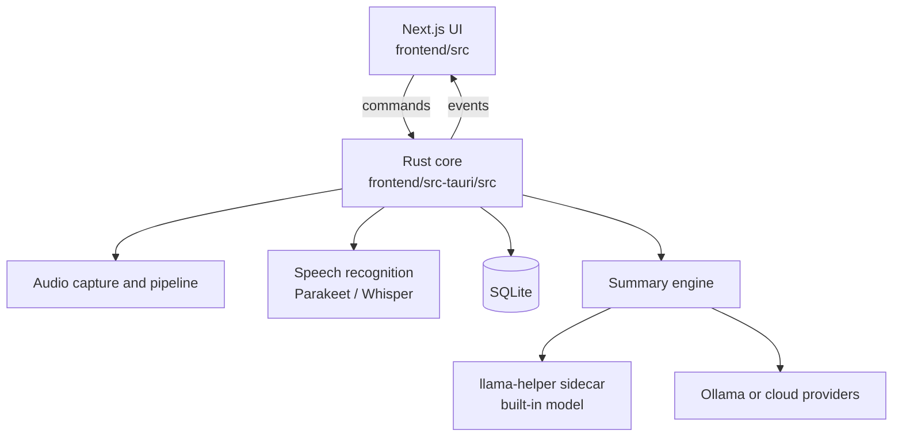
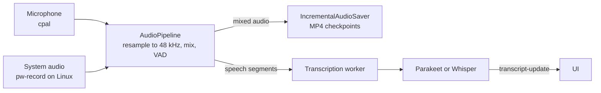

# Architecture

TriNote is a single desktop application built with [Tauri 2](https://tauri.app/). A Next.js user interface runs in the system webview and talks to a Rust core through Tauri commands (UI → Rust) and events (Rust → UI). There is no separate server.

## Recording and transcription

- **Capture** (`audio/capture/`): the microphone through cpal; system audio through a Core Audio process tap on macOS, WASAPI loopback on Windows and `pw-record` (PipeWire) on Linux. Every stream is resampled to 48 kHz.
- **Pipeline** (`audio/pipeline.rs`): mixes microphone and system audio in 600 ms windows without ducking. Silero voice activity detection (`audio/vad.rs`, 16 kHz) cuts the mix into speech segments.
- **Recording** (`audio/incremental_saver.rs`): the mixed audio is written as MP4 checkpoints every 30 seconds and joined with FFmpeg when the recording stops, so a crash loses at most the last 30 seconds of audio.
- **Transcription** (`audio/transcription/`): one worker transcribes segments in order and emits `transcript-update` events. Each segment is saved with its timestamps and language.

## Speech recognition engines

- **Parakeet** (`parakeet_engine/`): NVIDIA Parakeet TDT 0.6B through ONNX Runtime on the CPU. Fast, English and European languages only.
- **Whisper** (`whisper_engine/`): whisper.cpp through whisper-rs.
  - The restricted language mode (`auto:en,vi,zh`) detects each segment's language with a small model (`base`) and decodes it in the most likely allowed language.
  - The encoder context is sized to the segment instead of a padded 30-second window.
  - `whisper_engine/acceleration.rs` picks the GPU: the first discrete GPU, then an integrated one, then the CPU.

## Summaries

`summary/` builds prompts from transcript chunks and sends them to the selected provider:

- **Built-in AI:** the `llama-helper` sidecar (`llama-helper/`), a separate process running llama.cpp and talking JSON over stdin/stdout. It is started on demand and stopped after a period of inactivity. Running it as its own process means a crash in the GPU driver cannot take the app down.
- **Ollama, OpenAI, Anthropic, Groq, OpenRouter and custom OpenAI-compatible servers:** HTTP clients in their own modules.

Chunk sizes come from per-script token estimates, so Chinese and Vietnamese transcripts fit the model's context. Templates in `src-tauri/templates/` describe the summary sections.

## Hardware acceleration and crash recovery

`hardware_acceleration.rs` stores the user's choice (GPU when available, or CPU only) in `acceleration.json`.

- **Whisper.** While Whisper loads or runs on the GPU, a marker file exists. If the app starts and finds it, the previous run crashed on the GPU, so speech recognition switches to the CPU and the UI is told.
- **Summaries.** If `llama-helper` dies while using the GPU, the request is retried with `LLAMA_CPU_ONLY` set.

## Storage

- **SQLite** (`database/`, migrations in `src-tauri/migrations/`): meetings, transcript segments, summaries and settings, in the app data folder (`~/.local/share/com.trinhhuutho.trinote/` on Linux).
- **Recordings:** one folder per meeting (`audio.mp4`, `transcripts.json`, `metadata.json`) under `~/Documents/trinote-recordings/` by default.
- **Models:** under `models/` in the app data folder.

## Export

PDF export runs in the webview (`frontend/src/lib/pdf/meetingPdf.ts`) with pdfmake and the bundled Noto fonts. The Rust command `save_pdf_file` shows the save dialog and writes the file.
